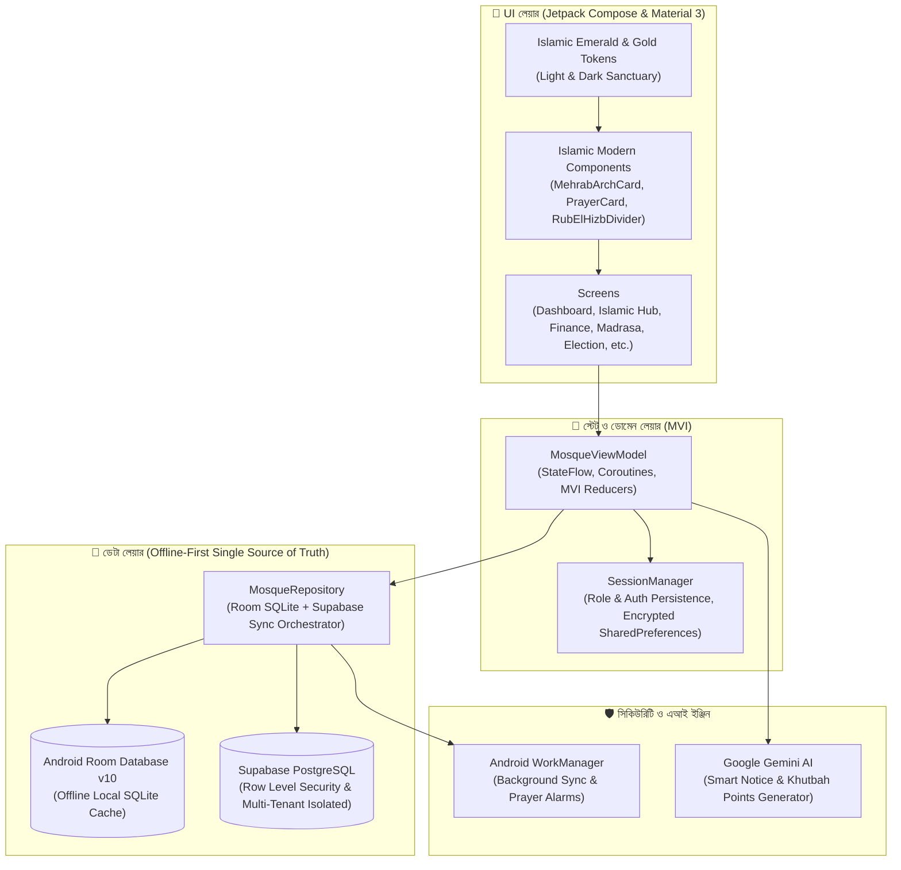

<p align="center">
  
</p>

# 🕌 মসজিদ সেবা — Mosque Seba

<p align="center">
  <strong>মসজিদের খেদমতে আধুনিক প্রযুক্তি, পরিচালনায় স্বচ্ছ আস্থা</strong><br>
  <em>Serving the House of Allah with Modern Technology & Transparent Trust</em>
</p>

<p align="center">
  <a href="https://github.com/emranmofficials/Mosque-Seba/releases/latest"></a>
  
  
  
  
  
  
  
  <a href="LICENSE"></a>
  <a href="https://github.com/emranmofficials/Mosque-Seba/actions"></a>
</p>

---

## 📥 অফিসিয়াল রিলিজ ও সরাসরি ডাউনলোড (Official Production Release)

মসজিদ সেবার সর্বশেষ প্রোডাকশন-রেডি সংস্করণ **v1.1.5** সরাসরি ডাউনলোড করার জন্য প্রস্তুত:

| ফরম্যাট | ফাইলনেম | সাইজ | ডাউনলোড লিংক | বিবরণ |
| :--- | :--- | :---: | :---: | :--- |
| 📦 **Android APK** | `Mosque-Seba-v1.1.5.apk` | `~16.6 MiB` | [**📥 সরাসরি APK ডাউনলোড করুন**](https://github.com/emranmofficials/Mosque-Seba/releases/download/v1.1.5/Mosque-Seba-v1.1.5.apk) | সরাসরি যেকোনো অ্যান্ড্রয়েড ডিভাইসে ইনস্টল করার জন্য প্রস্তুত। |
| 📱 **App Bundle (AAB)** | `Mosque-Seba-v1.1.5.aab` | `~16.2 MiB` | [**📥 অফিসিয়াল AAB ডাউনলোড করুন**](https://github.com/emranmofficials/Mosque-Seba/releases/download/v1.1.5/Mosque-Seba-v1.1.5.aab) | গুগল প্লে স্টোর ও অফিশিয়াল স্টোর রিলিজের জন্য অপ্টিমাইজড বান্ডেল। |

> 🔑 **অফিসিয়াল সিকিউর সাইনিং কি:** এই রিলিজটি স্থায়ী অফিসিয়াল রিলিজ কি-স্টোর (`keystore/mosque-seba.jks`) দ্বারা স্বাক্ষরিত। পরবর্তী যেকোনো আপডেটে অ্যাপ আনইনস্টল না করেই সরাসরি নির্বিঘ্নে আপডেট করা যাবে।

---

## 📖 সূচিপত্র (Table of Contents)
- [📌 পরিচিতি ও মূল দর্শন (Overview & Philosophy)](#-পরিচিতি-ও-মূল-দর্শন-overview--philosophy)
- [🎨 ব্র্যান্ড আইডেন্টিটি (Brand Identity)](#-ব্র্যান্ড-আইডেন্টিটি-brand-identity)
- [🌟 পূর্ণাঙ্গ মডিউল ও ফিচারসমূহ (Core Modules & Features)](#-পূর্ণাঙ্গ-মডিউল-ও-ফিচারসমূহ-core-modules--features)
- [👥 পদভিত্তিক স্বতন্ত্র ইন্টারফেস ম্যাট্রিক্স (Role-Based Interface Matrix)](#-পদভিত্তিক-স্বতন্ত্র-ইন্টারফেস-ম্যাট্রিক্স-role-based-interface-matrix)
- [🏛️ সিস্টেম আর্কিটেকচার (System Architecture)](#️-সিস্টেম-আর্কিটেকচার-system-architecture)
- [🎨 ইসলামিক মডার্ন ডিজাইন সিস্টেম (Design System)](#-ইসলামিক-মডার্ন-ডিজাইন-সিস্টেম-design-system)
- [🛡️ নিরাপত্তা, ডাটাবেজ ও ডেটা নীতি (Security & Privacy)](#️-নিরাপত্তা-ডাটাবেজ-ও-ডেটা-নীতি-security--privacy)
- [🚀 লোকাল সেটআপ ও রান করার নিয়ম (Getting Started)](#-লোকাল-সেটআপ-ও-রান-করার-নিয়ম-getting-started)
- [⚙️ Supabase ক্লাউড ব্যাকএন্ড কনফিগারেশন (Backend Setup)](#️-supabase-ক্লাউড-ব্যাকএন্ড-কনফিগারেশন-backend-setup)
- [🤝 অবদান রাখুন (Contributing)](#-অবদান-রাখুন-contributing)
- [📄 লাইসেন্স ও সৌজন্য (License & Authors)](#-লাইসেন্স-ও-সৌজন্য-license--authors)

---

## 📌 পরিচিতি ও মূল দর্শন (Overview & Philosophy)

**মসজিদ সেবা (Mosque Seba)** হলো একটি পূর্ণাঙ্গ, আধুনিক এবং ইসলামিক ভাবগাম্ভীর্যপূর্ণ ওপেন-সোর্স মসজিদ ও মাদরাসা পরিচালনা ইকোসিস্টেম। 

ঐতিহ্যগতভাবে মসজিদ পরিচালনার ক্ষেত্রে হিসাব-নিকাশের অস্বচ্ছতা, ম্যানুয়াল রসিদ বই হারিয়ে যাওয়া, মাসিক চাঁদা আদায়ে দীর্ঘসূত্রিতা, মাদরাসা শিক্ষার্থীদের তালিম ট্র্যাকিংয়ের অভাব এবং কার্যকরী যোগাযোগের সীমাবদ্ধতা দেখা যায়। **মসজিদ সেবা** এই সকল সমস্যার সমাধান এনেছে একটি একক আধুনিক ডিজিটাল প্ল্যাটফর্মে।

### আমাদের মূল দর্শন:
- 🤲 **স্বচ্ছ বায়তুল মাল:** প্রতিটি টাকার পুঙ্খানুপুঙ্খ অডিট ট্রেইল, দ্বি-স্তর অনুমোদন (Two-tier approvals) ও জিরো ফ্লোটিং পয়েন্ট হিসাব।
- 🕌 **মেহরাবের খেদমত:** ইমাম, মুয়াজ্জিন ও খাদেমদের সঠিক দায়িত্ব বণ্টন, ওয়াক্ত ডিউটি রোস্টার, খাবার শিডিউল ও সম্মানজনক সময়ে বেতন নিশ্চিতকরণ।
- 📖 **তালিম ও তারবিয়াত:** মাদরাসা ও মক্তবের হিফজ শিক্ষার্থীদের পারা ও পৃষ্ঠাভিত্তিক দৈনিক মূল্যায়ন ও অভিভাবক পোর্টাল।
- 🗳️ **গণতান্ত্রিক নেতৃত্ব:** স্বচ্ছ ও উৎসবমুখর মসজিদ কমিটি গঠন প্রক্রিয়ার জন্য ডিজিটাল নির্বাচন ও ব্যালট ভোটিং ব্যবস্থা।
- 🤝 **সমাজকল্যাণ ও যাকাত:** সমাজের বিধবা, এতিম ও অসুস্থদের কাছে দ্রুত ত্রাণ ও চিকিৎসা অনুদান পৌঁছে দেওয়া।
- 📴 **শতভাগ অফলাইন-ফার্স্ট:** ইন্টারনেট সংযোগ না থাকলেও স্থানীয় মেমোরিতে অ্যাপের প্রতিটি ফিচার নিখুঁতভাবে সচল থাকে।

---

## 🎨 ব্র্যান্ড আইডেন্টিটি (Brand Identity)

<p align="center">
  
  &nbsp;&nbsp;&nbsp;&nbsp;&nbsp;&nbsp;&nbsp;&nbsp;&nbsp;&nbsp;
  
</p>
<p align="center">
  <em>বামে: মসজিদ সেবার অফিশিয়াল ভেক্টর লোগো &nbsp;&nbsp;|&nbsp;&nbsp; ডানে: ৩ডি লঞ্চার আইকন (৫১২×৫১২)</em>
</p>

* **অ্যাপের নাম:** মসজিদ সেবা (Mosque Seba)
* **অ্যাপ্লিকেশন প্যাকেজ:** `com.mosqueseba.app`
* **অফিসিয়াল স্লোগান:** *মসজিদের খেদমতে আধুনিক প্রযুক্তি, পরিচালনায় স্বচ্ছ আস্থা*
* **প্রধান রং:** এমারেল্ড গ্রিন (`#0D5C3A`), রয়্যাল ইসলামিক গোল্ড (`#D4AF37`), এবং লাইট/ডার্ক ব্যাকগ্রাউন্ড।

---

## 🌟 পূর্ণাঙ্গ মডিউল ও ফিচারসমূহ (Core Modules & Features)

| আইকন | মডিউল | মূল কার্যকারিতা ও বিবরণ |
| :---: | :--- | :--- |
| 🏠 | **স্মার্ট ড্যাশবোর্ড ও সালাত হাব** | ৫ ওয়াক্তের নামাজের আজান ও জামাত সময়সূচি, পরবর্তী ওয়াক্তের লাইভ কাউন্টডাউন, হিজরি ও বাংলা ক্যালেন্ডার ব্যানার এবং আর্থিক স্থিতি। |
| 📜 | **সহিহ হাদিস ডিজিটাল বোর্ড** | বুখারি ও মুসলিম শরিফের প্রামাণ্য সহিহ হাদিস প্রতিদিন স্বয়ংক্রিয়ভাবে পরিবর্তিত হয়ে মুসল্লিদের অন্তরে দ্বীনি আলো ছড়ায় (১০০% অফলাইন)। |
| 🌙 | **ইসলামিক ক্যালেন্ডার ও ইভেন্ট হাব** | পবিত্র আশুরা, সীরাতুন্নবী (সা:), শবে মেরাজ, শবে বরাত, পবিত্র রমজান, লাইলাতুল কদর, ঈদুল ফিতর, আরাফাহ, ঈদুল আজহা সহ ১৩টি বাৎসরিক দিবসের রিয়েল-টাইম ট্র্যাকিং ও কাউন্টডাউন। |
| 🌖 | **চাঁদ দেখার অফসেট সমন্বয়** | স্থানীয় চাঁদ দেখার ওপর ভিত্তি করে ১ ক্লিকেই -১ দিন, স্বাভাবিক বা +১ দিন স্থায়ী মেমোরি অ্যাডজাস্ট করার সুবিধা। |
| 🤖 | **জেমিনি এআই বয়ান ও খুতবা সহায়িকা** | গুগল জেমিনি এআই ইন্টিগ্রেশনের মাধ্যমে প্রতিটি ইসলামিক দিবসে খতিব ও ইমামদের জন্য জুমার বয়ানের পয়েন্ট ও মুসল্লিদের নফল আমলের পূর্ণাঙ্গ গাইডলাইন তৈরি। |
| 💰 | **স্বচ্ছ ফিন্যান্স ও বায়তুল মাল অডিট** | নগদ ও ব্যাংক লেজার, আয়ের শ্রেণিবিভাগ, ব্যয়ের দুই-স্তরের অনুমোদন (Two-tier approvals), সেন্ট-ভিত্তিক নিখুঁত হিসাব ও বিস্তারিত মাসিক অডিট রিপোর্ট। |
| 🧾 | **ডিজিটাল কিউআর রসিদ ও চাঁদা** | চাঁদা ও অনুদান আদায়ের পর তাৎক্ষণিক ডিজিটাল ভেরিফায়েড রসিদ তৈরি (অনলাইন ভেরিফিকেশন QR কোড ও সোশ্যাল শেয়ারিং সহ)। |
| 🗳️ | **কমিটি নির্বাচন ও ভোটিং সিস্টেম** | সভাপতি, সাধারণ সম্পাদক সহ বিভিন্ন পদের জন্য স্বচ্ছ প্রার্থী তালিকা, ভোটার ব্যালট ভোট গ্রহণ ও রিয়েল-টাইম ফলাফল ট্র্যাকিং। |
| 👥 | **সদস্য ও ওয়াকফ সম্পদ ডিরেক্টরি** | সাধারণ ও আজীবন সদস্যদের প্রোফাইল, রক্তের গ্রুপ, মোবাইল ও NID এবং মসজিদের স্থাবর-অস্থাবর ওয়াকফ সম্পত্তির ডিজিটাল রেজিস্টার। |
| 📚 | **মাদরাসা ও মক্তব হিফজ তালিম** | শিক্ষার্থী ভর্তি, দৈনিক হাজিরা, পারা/পৃষ্ঠাভিত্তিক হিফজ ও নাজেরা মূল্যায়ন (স্টার রেটিং), বেতন ফি ও অভিভাবক পোর্টাল। |
| 👔 | **ইমাম ও স্টাফ পে-রোল** | ইমাম, মুয়াজ্জিন ও খাদেমদের মাসিক বেতন ও ঈদ বোনাস বিতরণ (স্বয়ংক্রিয়ভাবে ফিন্যান্সে ব্যয় পোস্টিং সহ)। |
| 🕌 | **ওয়াক্ত ডিউটি রোস্টার** | ৫ ওয়াক্ত নামাজের ইমামতি, আজান ও জুমার খুতবার দায়িত্ব বণ্টন ও সাপ্তাহিক তদারকি ক্যালেন্ডার। |
| 🍲 | **খাবার শিডিউল ট্র্যাকার** | ইমাম ও খাদেমদের দৈনিক দুপুর ও রাতের খাবার সরবরাহকারী পরিবারের তালিকা ও সুষম বণ্টন ট্র্যাকার। |
| 🤝 | **সমাজকল্যাণ ও যাকাত তহবিল** | চিকিৎসা অনুদান, বিধবা ও এতিম ভাতা, শিক্ষা সাহায্য এবং জরুরি আপৎকালীন সাহায্য আবেদন নিষ্পত্তি। |
| 📢 | **ডিজিটাল নোটিশ ও নোটিফিকেশন** | জরুরি নোটিশ ও রেজুলেশন প্রকাশ, ১-ক্লিকে নোটিশ খসড়া তৈরি ও পুশ নোটিফিকেশন ব্রডকাস্ট। |
| ✍️ | **ডিজিটাল স্বাক্ষর ও অফিশিয়াল সিল** | টাচ স্ক্রিনে ক্যানভাস সিগনেচার ড্রয়িং প্যাড, সিল স্ট্যাম্প আপলোড এবং সকল রসিদ ও ভাউচারে ডিজিটাল পদবিসহ সিল-স্বাক্ষর সংযোজন। |
| 📦 | **জুমার ক্যাশবক্স ৩-সাক্ষী কাউন্টার** | জুমার নামাজের দানবাক্স খোলার পর ১০০০ থেকে ৫ টাকার নোটের লাইভ ক্যাশ কাউন্টিং, ৩ জন স্বতন্ত্র সাক্ষীর স্বাক্ষর ও স্বয়ংক্রিয় ভাউচার পোস্টিং। |
| 🖨️ | **১-ক্লিক নেটিভ প্রিন্ট ও পিডিএফ** | চাঁদার রসিদ, ব্যয় ভাউচার, বেতন স্লিপ এবং নোটিশ তাৎক্ষণিকভাবে সরাসরি প্রিন্টারে প্রিন্ট বা মোবাইল ফ্রেন্ডলি পিডিএফ জেনারেশন। |
| 🎨 | **দাওয়াতনামা মাহফিল পোস্টার এআই** | জেমিনি এআই দিয়ে ইসলামী ওয়াজ মাহফিল ও আলোচনা সভার দৃষ্টিনন্দন পোস্টার প্রম্পট ও ইভেন্ট দাওয়াতনামা স্বয়ংক্রিয়ভাবে রচনা। |
| 🚨 | **জরুরি জানাজা অ্যালার্ট ব্রডকাস্টার** | এলাকার কোনো মুসল্লির ইন্তেকালে তাৎক্ষণিক জানাজার সময়, স্থান ও কবরস্থান উল্লেখ করে সরাসরি এসএমএস ও হোয়াটসঅ্যাপ ব্রডকাস্ট। |
| 🌙 | **পবিত্র রমজান স্পেশাল হাব** | সেহরি ও ইফতারের লাইভ কাউন্টডাউন টাইমার, তারাবিহর নামাজ ও ইতিকাফ ট্র্যাকিং এবং পূর্ণাঙ্গ খতমে কুরআন অগ্রগতি ট্র্যাকার। |
| 📴 | **অফলাইন-ফার্স্ট ও মাল্টি-টেন্যান্ট ক্লাউড** | ইন্টারনেট ছাড়াও সমস্ত ফিচার সচল থাকে, এবং ব্যাকএন্ডে সুনির্দিষ্ট `mosque_id` দিয়ে Supabase RLS ক্লাউড ব্যাকআপ। |

---

## 👥 পদভিত্তিক স্বতন্ত্র ইন্টারফেস ম্যাট্রিক্স (Role-Based Interface Matrix)

অ্যাপটিতে কমিটির প্রতিটি পদের মর্যাদা ও গোপনীয়তা রক্ষার জন্য কঠোরভাবে রোল-বেসড ফিচার বিভাজন (Role-Responsibility Isolation) বাস্তবায়ন করা হয়েছে:

```
┌─────────────────────────────────────────────────────────────────┐
│               কমিটি পদবি অনুযায়ী ইন্টারফেস কাঠামো                │
├─────────────────┬───────────────────────────────────────────────┤
│ 👑 সভাপতি        │ কেন্দ্রীয় কমান্ড রুম, ব্যয় ভাউচার চূড়ান্ত   │
│                 │ অনুমোদন ও বাতিল, অডিট, নির্বাচন ও রেজুলেশন। │
├─────────────────┼───────────────────────────────────────────────┤
│ 💰 কোষাধ্যক্ষ    │ আয়-ব্যয়ের লেজার, চাঁদা কালেকশন, ডিজিটাল রসিদ, │
│                 │ স্টাফ বেতন ও ফি কালেকশন (মিটিং/রোল মুক্ত)।     │
├─────────────────┼───────────────────────────────────────────────┤
│ 📝 সাধারণ সম্পাদক│ সদস্য পরিষদ, কার্যনির্বাহী সভা আহ্বান, নোটিশ │
│                 │ জারি, রেজুলেশন ও সমাজকল্যাণ আবেদন ব্যবস্থাপনা।  │
├─────────────────┼───────────────────────────────────────────────┤
│ 🕌 ইমাম ও খাদেম  │ মেহরাব খেদমত, ৫ ওয়াক্ত নামাজ রোস্টার, খাবার   │
│                 │ শিডিউল, মাদরাসা হিফজ তালিম ও বেতন স্লিপ।       │
├─────────────────┼───────────────────────────────────────────────┤
│ 👥 সাধারণ মুসুল্লি│ নামাজ কাউন্টডাউন, নিজস্ব চাঁদার ডিজিটাল রসিদ, │
│                 │ উন্মুক্ত আয়-ব্যয় স্থিতি, ভোট প্রদান ও কল্যাণ।  │
└─────────────────┴───────────────────────────────────────────────┘
```

---

## 🏛️ সিস্টেম আর্কিটেকচার (System Architecture)

প্রজেক্টটি আধুনিক **Clean Architecture** এবং **MVI (Model-View-Intent)** আর্কিটেকচারাল প্যাটার্ন অনুসরণ করে তৈরি:



---

## 🎨 ইসলামিক মডার্ন ডিজাইন সিস্টেম (Design System)

অ্যাপটিতে কোনো জেনেরিক ডিজাইন ব্যবহার না করে সম্পূর্ণ খাঁটি ইসলামিক মেহরাব ও নকশার রূপ দেওয়া হয়েছে:

| কালার টোকেন | হেক্স কোড | প্রিভিউ | ব্যবহারক্ষেত্র |
| :--- | :--- | :---: | :--- |
| **Primary Emerald** | `#0D5C3A` | 🟩 | মূল অ্যাপ বার, অ্যাক্টিভ ট্যাব, প্রাথমিক বাটন |
| **Deep Sanctuary** | `#0A482D` | 🌲 | মেহরাব কার্ড হেডার, স্প্ল্যাশ ব্যাকগ্রাউন্ড |
| **Royal Islamic Gold**| `#D4AF37` | 🟨 | সোনালী বর্ডার, বিসমিল্লাহ ক্যালিগ্রাফি ফ্রেম |
| **Gold Amber Accent** | `#F59E0B` | 🍯 | গুরুত্বপূর্ণ ব্যাজ, কাউন্টডাউন টাইমার |
| **Dark Sanctuary** | `#0A1B14` | ⬛ | ডার্ক থিম সারফেস ও কার্ড ব্যাকগ্রাউন্ড |
| **Warm Parchment** | `#F6F8F6` | ⬜ | লাইট থিম ব্যাকগ্রাউন্ড ও সফট টেক্সট ফিল্ড |

### সিগনেচার কম্পোনেন্টস:
- **`MehrabArchCard`**: ঐতিহ্যবাহী মেহরাবের আদলে ২৪ডিপি আর্চ কার্ভ এবং সোনালী ডিভাইডার সহ প্রিমিয়াম কার্ড।
- **`RubElHizbDivider`**: সোনালী জ্যামিতিক ইসলামিক স্টার মোটিফ (۞) সমৃদ্ধ ডিভাইডার।
- **`HijriDateBanner`**: বিসমিল্লাহ ক্যালিগ্রাফি এবং লাইভ হিজরি ও বাংলা তারিখ প্রদর্শক ব্যানার।
- **`IslamicCard`**: সূক্ষ্ম গোল্ডেন বর্ডার ও কার্ভড শ্যাডোর প্রিমিয়াম কার্ড ভিউ।

---

## 🛡️ নিরাপত্তা, ডাটাবেজ ও ডেটা নীতি (Security & Privacy)

- **১০০% ডেমো ডেটামুক্ত প্রোডাকশন ডাটাবেজ:** অ্যাপটিতে কোনো কাল্পনিক ফেক ডেটা নেই। প্রথমবার ইনস্টল করলেই এটি সম্পূর্ণ ক্লিন ও ফ্রেশ স্টেট দিয়ে শুরু হয়।
- **কঠোর মাল্টি-টেন্যান্ট আইসোলেশন:** প্রতিটি মসজিদের ডেটা সুনির্দিষ্ট `mosque_id` দ্বারা সম্পূর্ণ পৃথক এবং Supabase PostgreSQL Row Level Security (RLS) দ্বারা লক করা।
- **জিরো ফ্লোটিং পয়েন্ট হিসাব:** সকল আর্থিক হিসাব সেন্ট ও পূর্ণাঙ্গ সংখ্যায় পরিচালিত—কোনো প্রকার রাউন্ডিং এরর ছাড়া।
- **অপরিবর্তনীয় অডিট ট্রেইল:** প্রতিটি ভাউচার এন্ট্রি, অনুমোদন এবং ব্যয়ের স্থায়ী ক্রিপ্টোগ্রাফিক টাইমস্ট্যাম্পড অডিট রেকর্ড সংরক্ষিত থাকে।
- **ডিজিটাল রসিদ যাচাইকরণ:** প্রতিটি ভাউচার ও রসিদে ডায়নামিক কিউআর কোড থাকে, যা স্ক্যান করলেই মসজিদ ও রসিদের সত্যতা প্রমাণিত হয়।

---

## 🚀 লোকাল সেটআপ ও রান করার নিয়ম (Getting Started)

### প্রয়োজনীয় টুলস:
- **Android Studio:** Ladybug (2024.2+) বা Koala
- **JDK:** OpenJDK 17 বা 21
- **Android SDK:** Compile SDK 35, Min SDK 26, Target SDK 35

### রিপোজিটরি ক্লোন ও বিল্ড:
```bash
# ১. রিপোজিটরি ক্লোন করুন
git clone https://github.com/emranmofficials/Mosque-Seba.git

# ২. প্রজেক্ট ফোল্ডারে প্রবেশ করুন
cd Mosque-Seba

# ৩. ইউনিট টেস্টগুলো চালান
./gradlew testDebugUnitTest

# ৪. রিলিজ APK তৈরি করুন
./gradlew assembleRelease
```
*তৈরিকৃত APK পাওয়া যাবে:* `app/build/outputs/apk/release/app-release.apk`

---

## ⚙️ Supabase ক্লাউড ব্যাকএন্ড কনফিগারেশন (Backend Setup)

প্রজেক্টের রুট ডিরেক্টরিতে `supabase/` ফোল্ডারে ক্লাউড ডেটাবেজের সকল স্কিমা ও মাইগ্রেশন স্ক্রিপ্ট অন্তর্ভুক্ত রয়েছে:
* `supabase/schema.sql`: মাল্টি-টেন্যান্ট টেবিল স্কিমা, ফরেন কি এবং ইনডেক্স।
* `supabase/rls_policies.sql`: প্রতিটি মসজিদের ডেটার জন্য সুদৃঢ় Row Level Security (RLS) নীতিমালা।
* `supabase/functions/`: সার্ভারলেস নোটিফিকেশন ও এসএমএস গেটওয়ে ট্রিগার ফাংশন।

---

## 🤝 অবদান রাখুন (Contributing)

আমরা যে কোনো ধরণের অবদান—বাগ ফিক্স, নতুন আইডিয়া, ডিজাইন উন্নয়ন বা ডকুমেন্টেশনকে সানন্দে স্বাগত জানাই!
বিস্তারিত জানার জন্য অনুগ্রহ করে আমাদের **[CONTRIBUTING.md](CONTRIBUTING.md)** নির্দেশিকা এবং **[CODE_OF_CONDUCT.md](CODE_OF_CONDUCT.md)** দেখুন।

---

## 📄 লাইসেন্স ও সৌজন্য (License & Authors)

* **প্রজেক্ট মেইন্টেইনার ও আর্কিটেক্ট:** [Emran Mahmud (@emranmofficials)](https://github.com/emranmofficials)
* **লাইসেন্স:** এই প্রজেক্টটি **[MIT License](LICENSE)**-এর অধীনে উন্মুক্ত ও লাইসেন্সকৃত।
* **কপিরাইট:** © ২০২৪–২০২৬ Emran Mahmud & Mosque Seba Contributors.

<p align="center">
  <sub>اللهم اجعل هذا العمل خالصاً لوجهك الكريم وتقبله منا إنك أنت السميع العليم</sub><br>
  <em>হে আল্লাহ! এই দ্বীনি খেদমতকে একান্তভাবে তোমার সন্তুষ্টির উদ্দেশ্যে কবুল করে নাও। নিশ্চয়ই তুমি সর্বশ্রোতা, সর্বজ্ঞ।</em>
</p>
