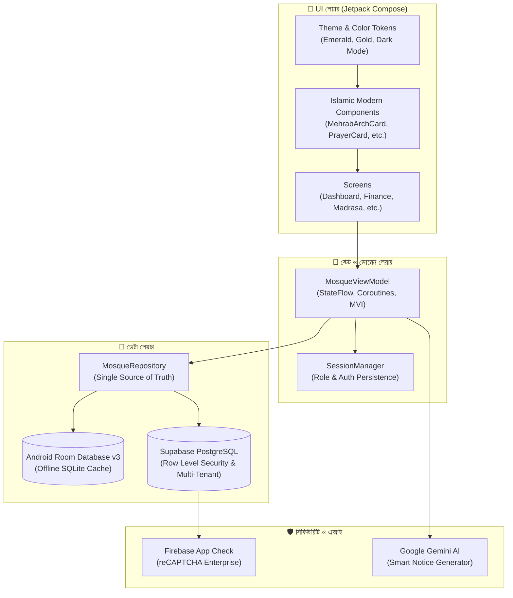

<p align="center">
  
</p>

# 🕌 মসজিদ সেবা — Mosque Seba

<p align="center">
  <strong>মসজিদের খেদমতে আধুনিক প্রযুক্তি, পরিচালনায় স্বচ্ছ আস্থা</strong><br>
  <em>Serving the House of Allah with Modern Technology & Transparent Trust</em>
</p>

<p align="center">
  <a href="https://github.com/emranmofficials/Mosque-Seba/releases"></a>
  
  
  
  
  
  <a href="LICENSE"></a>
  <a href="https://github.com/emranmofficials/Mosque-Seba/pulls"></a>
</p>

---

## 📖 সূচিপত্র (Table of Contents)
- [📌 পরিচিতি ও উদ্দেশ্য (Overview & Vision)](#-পরিচিতি-ও-উদ্দেশ্য-overview--vision)
- [🎨 ব্র্যান্ড আইডেন্টিটি (Brand Identity)](#-ব্র্যান্ড-আইডেন্টিটি-brand-identity)
- [🌟 মূল মডিউল ও ফিচারসমূহ (Core Features)](#-মূল-মডিউল-ও-ফিচারসমূহ-core-features)
- [👥 পদভিত্তিক স্বতন্ত্র ইন্টারফেস (Role-Based Interface Matrix)](#-পদভিত্তিক-স্বতন্ত্র-ইন্টারফেস-role-based-interface-matrix)
- [🏛️ সিস্টেম আর্কিটেকচার (System Architecture)](#️-সিস্টেম-আর্কিটেকচার-system-architecture)
- [🎨 ইসলামিক মডার্ন ডিজাইন সিস্টেম (Design System)](#-ইসলামিক-মডার্ন-ডিজাইন-সিস্টেম-design-system)
- [🛡️ নিরাপত্তা ও ডেটা নীতি (Security & Privacy)](#️-নিরাপত্তা-ও-ডেটা-নীতি-security--privacy)
- [🚀 ইনস্টলেশন ও রান করার নিয়ম (Getting Started)](#-ইনস্টলেশন-ও-রান-করার-নিয়ম-getting-started)
- [🤝 অবদান রাখুন (Contributing)](#-অবদান-রাখুন-contributing)
- [📄 লাইসেন্স ও সৌজন্য (License & Authors)](#-লাইসেন্স-ও-সৌজন্য-license--authors)

---

## 📌 পরিচিতি ও উদ্দেশ্য (Overview & Vision)

**মসজিদ সেবা (Mosque Seba)** হলো একটি পূর্ণাঙ্গ, আধুনিক এবং ইসলামিক ভাবগাম্ভীর্যপূর্ণ ওপেন-সোর্স মসজিদ ও মাদরাসা পরিচালনা ইকোসিস্টেম। 

ঐতিহ্যগতভাবে মসজিদ পরিচালনার ক্ষেত্রে হিসাব-নিকাশের অস্বচ্ছতা, ম্যানুয়াল রসিদ বই হারিয়ে যাওয়া, মাসিক চাঁদা আদায়ে দীর্ঘসূত্রিতা, মাদরাসা শিক্ষার্থীদের তালিম ট্র্যাকিংয়ের অভাব এবং কার্যকরী যোগাযোগের সীমাবদ্ধতা দেখা যায়। **মসজিদ সেবা** এই সকল সমস্যার সমাধান এনেছে একটি একক আধুনিক ডিজিটাল প্ল্যাটফর্মে।

### আমাদের মূল দর্শন:
- 🤲 **স্বচ্ছ আমানত:** বায়তুল মালের প্রতিটি টাকার পুঙ্খানুপুঙ্খ অডিট ট্রেইল ও দ্বৈত-অনুমোদন ব্যবস্থা।
- 🕌 **মেহরাবের খেদমত:** ইমাম, মুয়াজ্জিন ও খাদেমদের সঠিক দায়িত্ব বণ্টন ও সম্মানজনক সময়ে বেতন-ভাতা নিশ্চিতকরণ।
- 📖 **তালিম ও তারবিয়াত:** মাদরাসা ও মক্তবের হিফজ শিক্ষার্থীদের পারা ও পৃষ্ঠাভিত্তিক দৈনিক মূল্যায়ন।
- 🤝 **সমাজকল্যাণ ও যাকাত:** সমাজের বিধবা, এতিম ও অসুস্থদের কাছে দ্রুত ত্রাণ ও সাহায্য পৌঁছে দেওয়া।

---

## 🎨 ব্র্যান্ড আইডেন্টিটি (Brand Identity)

<p align="center">
  
  &nbsp;&nbsp;&nbsp;&nbsp;&nbsp;&nbsp;&nbsp;&nbsp;&nbsp;&nbsp;
  
</p>
<p align="center">
  <em>বামে: মসজিদ সেবার অফিশিয়াল ভেক্টর লোগো &nbsp;&nbsp;|&nbsp;&nbsp; ডানে: ৩ডি লঞ্চার আইকন (৫১২×৫১২)</em>
</p>

- **অ্যাপের নাম:** মসজিদ সেবা (Mosque Seba)
- **প্যাকেজ আইডি:** `com.mosqueseba.app`
- **অফিসিয়াল স্লোগান:** *মসজিদের খেদমতে আধুনিক প্রযুক্তি, পরিচালনায় স্বচ্ছ আস্থা*
- **প্রধান রং:** এমারেল্ড গ্রিন (`#0D5C3A`), রয়্যাল ইসলামিক গোল্ড (`#D4AF37`), এবং লাইট/ডার্ক ব্যাকগ্রাউন্ড।

---

## 🌟 মূল মডিউল ও ফিচারসমূহ (Core Features)

| আইকন | মডিউল | মূল কার্যকারিতা ও বিবরণ |
| :---: | :--- | :--- |
| 🏠 | **স্মার্ট ড্যাশবোর্ড** | ৫ ওয়াক্তের নামাজের আজান ও জামাত সময়সূচি, পরবর্তী ওয়াক্তের কাউন্টডাউন, হিজরি ও বাংলা ক্যালেন্ডার ব্যানার এবং আর্থিক স্থিতি। |
| 👥 | **সদস্য ডিরেক্টরি** | সাধারণ ও আজীবন সদস্যদের প্রোফাইল, রক্তের গ্রুপ, মোবাইল ও NID যাচাই এবং বাৎসরিক/মাসিক চাঁদা ট্র্যাকিং। |
| 💰 | **স্বচ্ছ ফিন্যান্স ও অডিট** | নগদ ও ব্যাংক লেজার, আয়ের শ্রেণিবিভাগ, ব্যয়ের দুই-স্তরের অনুমোদন (Two-tier approvals) ও বিস্তারিত মাসিক অডিট রিপোর্ট। |
| 🧾 | **ডিজিটাল কিউআর রসিদ** | চাঁদা ও অনুদান আদায়ের পর তাৎক্ষণিক ডিজিটাল ভেরিফায়েড রসিদ তৈরি (অনলাইন ভেরিফিকেশন QR কোড সহ)। |
| 📚 | **মাদরাসা ও মক্তব** | শিক্ষার্থী ভর্তি, দৈনিক হাজিরা, পারা/পৃষ্ঠাভিত্তিক হিফজ ও নাজেরা মূল্যায়ন (স্টার রেটিং), বেতন ফি ও অভিভাবক পোর্টাল। |
| 👔 | **ইমাম ও স্টাফ পে-রোল** | ইমাম, মুয়াজ্জিন ও খাদেমদের মাসিক বেতন ও ঈদ বোনাস বিতরণ (স্বয়ংক্রিয়ভাবে ফিন্যান্সে ব্যয় পোস্টিং সহ)। |
| 🕌 | **ওয়াক্ত ডিউটি রোস্টার** | ৫ ওয়াক্ত নামাজের ইমামতি, আজান ও জুমার খুতবার দায়িত্ব বণ্টন ও তদারকি ক্যালেন্ডার। |
| 🍲 | **খাবার শিডিউল ট্র্যাকার** | ইমাম ও খাদেমদের দৈনিক দুপুর ও রাতের খাবার সরবরাহকারী পরিবারের তালিকা ও বণ্টন ট্র্যাকার। |
| 🤝 | **সমাজকল্যাণ ও যাকাত** | চিকিৎসা অনুদান, বিধবা ও এতিম ভাতা, শিক্ষা সাহায্য এবং জরুরি আপৎকালীন আবেদন নিষ্পত্তি। |
| 📅 | **মাহফিল ও ইভেন্ট** | বার্ষিক ওয়াজ মাহফিল, শবে কদর, ইফতার আয়োজন, বক্তা তালিকা, বাজেট ও স্বেচ্ছাসেবক ট্র্যাকিং। |
| 📝 | **কমিটি সভা ও রেজুলেশন** | আসন্ন কার্যনির্বাহী সভার নোটিশ, এজেন্ডা ও সভায় গৃহীত সিদ্ধান্তের স্থায়ী ডিজিটাল রেজুলেশন আর্কাইভ। |
| ✨ | **জেমিনি এআই ড্রাফটার** | Google Gemini AI ইন্টিগ্রেশনের মাধ্যমে জরুরি নোটিশ ও রেজুলেশনের স্বয়ংক্রিয় ড্রাফট তৈরি। |
| 🌙 | **সম্পূর্ণ ডার্ক মোড** | রাতে চোখের প্রশান্তির জন্য বিশেষভাবে ডিজাইনকৃত ইসলামিক এমারেল্ড-ডার্ক থিম। |
| 📱 | **ট্যাবলেট ও ফোল্ডেবল** | বড় স্ক্রিনের ডিভাইসের জন্য স্বয়ংক্রিয় অ্যাডাপটিভ নেভিগেশন রেল (`MosqueNavigationRail`)। |

---

## 👥 পদভিত্তিক স্বতন্ত্র ইন্টারফেস (Role-Based Interface Matrix)

অ্যাপটিতে কমিটির প্রতিটি পদের দায়িত্ব ও গোপনীয়তা রক্ষার জন্য কঠোরভাবে ফিচার পৃথকীকরণ (Role-Responsibility Isolation) করা হয়েছে:

```
┌─────────────────────────────────────────────────────────────────┐
│               কমিটি পদবি অনুযায়ী ইন্টারফেস কাঠামো                │
├─────────────────┬───────────────────────────────────────────────┤
│ 👑 সভাপতি        │ কেন্দ্রীয় কমান্ড রুম, ব্যয় ভাউচার চূড়ান্ত   │
│                 │ অনুমোদন ও বাতিল, অডিট ও রেজুলেশন তদারকি।     │
├─────────────────┼───────────────────────────────────────────────┤
│ 💰 কোষাধ্যক্ষ    │ আয়-ব্যয়ের লেজার, চাঁদা কালেকশন, ডিজিটাল রসিদ, │
│                 │ স্টাফ বেতন ও ফি কালেকশন (মিটিং/রোল মুক্ত)।     │
├─────────────────┼───────────────────────────────────────────────┤
│ 📝 সাধারণ সম্পাদক│ সদস্য পরিষদ, কার্যনির্বাহী সভা আহ্বান, নোটিশ │
│                 │ জারি, রেজুলেশন ও সমাজকল্যাণ আবেদন ব্যবস্থাপনা।  │
├─────────────────┼───────────────────────────────────────────────┤
│ 🕌 ইমাম ও খাদেম  │ মেহরাব খেদমত, ৫ ওয়াক্ত নামাজ রোস্টার, খাবার   │
│                 │ শিডিউল, মাদরাসা হিফজ তালিম ও বেতন স্লিপ।       │
├─────────────────┼───────────────────────────────────────────────┤
│ 👥 সাধারণ মুসুল্লি│ নামাজ কাউন্টডাউন, নিজস্ব চাঁদার ডিজিটাল রসিদ, │
│                 │ উন্মুক্ত আয়-ব্যয় স্থিতি ও কল্যাণ আবেদন।        │
└─────────────────┴───────────────────────────────────────────────┘
```

---

## 🏛️ সিস্টেম আর্কিটেকচার (System Architecture)

প্রজেক্টটি আধুনিক **Clean Architecture** এবং **MVI (Model-View-Intent)** প্যাটার্ন অনুসরণ করে তৈরি:



---

## 🎨 ইসলামিক মডার্ন ডিজাইন সিস্টেম (Design System)

অ্যাপটিতে কোনো জেনেরিক ম্যাটেরিয়াল ডিজাইন ব্যবহার না করে সম্পূর্ণ খাঁটি ইসলামিক মেহরাব ও নকশার রূপ দেওয়া হয়েছে:

| কালার টোকেন | হেক্স কোড | প্রিভিউ | ব্যবহারক্ষেত্র |
| :--- | :--- | :---: | :--- |
| **Primary Emerald** | `#0D5C3A` | 🟩 | মূল অ্যাপ বার, অ্যাক্টিভ ট্যাব, প্রাথমিক বাটন |
| **Deep Sanctuary** | `#0A482D` | 🌲 | মেহরাব কার্ড হেডার, স্প্ল্যাশ ব্যাকগ্রাউন্ড |
| **Royal Islamic Gold**| `#D4AF37` | 🟨 | সোনালী বর্ডার, বিসমিল্লাহ ক্যালিগ্রাফি ফ্রেম |
| **Gold Amber Accent** | `#F59E0B` | 🍯 | গুরুত্বপূর্ণ ব্যাজ, কাউন্টডাউন টাইমার |
| **Dark Sanctuary** | `#0A1B14` | ⬛ | ডার্ক থিম সারফেস ও কার্ড ব্যাকগ্রাউন্ড |
| **Warm Parchment** | `#F6F8F6` | ⬜ | লাইট থিম ব্যাকগ্রাউন্ড ও সফট টেক্সট ফিল্ড |

### সিগনেচার কম্পোনেন্টস:
- **`MehrabArchCard`**: ঐতিহ্যবাহী মেহরাবের আদলে ২৪ডিপি আর্চ কার্ভ এবং সোনালী ডিভাইডার সহ প্রিমিয়াম কার্ড।
- **`RubElHizbDivider`**: সোনালী জ্যামিতিক ইসলামিক স্টার মোটিফ (۞) সমৃদ্ধ ডিভাইডার।
- **`HijriDateBanner`**: বিসমিল্লাহ ক্যালিগ্রাফি এবং লাইভ হিজরি ও বাংলা তারিখ প্রদর্শক ব্যানার।

---

## 🛡️ নিরাপত্তা ও ডেটা নীতি (Security & Privacy)

- **কঠোর মাল্টি-টেন্যান্ট আইসোলেশন:** প্রতিটি মসজিদের ডেটা সুনির্দিষ্ট `mosque_id` দ্বারা পৃথক এবং Supabase PostgreSQL Row Level Security (RLS) দ্বারা লক করা।
- **ফায়ারবেস অ্যাপ চেক (Firebase App Check):** অননুমোদিত বট বা ক্লায়েন্ট রিকোয়েস্ট থেকে ব্যাকএন্ড রক্ষায় reCAPTCHA Enterprise সক্রিয়।
- **জিরো ফ্লোটিং পয়েন্ট হিসাব:** সকল আর্থিক হিসাব সেন্ট ও পূর্ণাঙ্গ সংখ্যায় পরিচালিত—কোনো প্রকার রাউন্ডিং এরর ছাড়া।
- **অডিট ট্রেইল:** প্রতিটি ভাউচার, অনুমোদন এবং আর্থিক রদবদলের স্থায়ী অডিট রেকর্ড সংরক্ষিত থাকে।

---

## 🚀 ইনস্টলেশন ও রান করার নিয়ম (Getting Started)

### প্রয়োজনীয় টুলস:
- **Android Studio:** Ladybug (2024.2+) বা Koala
- **JDK:** OpenJDK 17 বা 21
- **Android SDK:** Compile SDK 35, Min SDK 26, Target SDK 35

### লোকাল মেশিনে রান করা:
```bash
# ১. রিপোজিটরি ক্লোন করুন
git clone https://github.com/emranmofficials/Mosque-Seba.git

# ২. প্রজেক্ট ফোল্ডারে প্রবেশ করুন
cd Mosque-Seba

# ৩. বিল্ড ও টেস্ট নিশ্চিত করুন
./gradlew testDebugUnitTest

# ৪. অ্যাপ রান করুন বা ডিবাগ APK তৈরি করুন
./gradlew assembleDebug
```
*তৈরিকৃত APK পাওয়া যাবে:* `app/build/outputs/apk/debug/app-debug.apk`

---

## 🤝 অবদান রাখুন (Contributing)

আমরা যে কোনো ধরণের অবদান—বাগ ফিক্স, নতুন আইডিয়া, ডিজাইন উন্নয়ন বা ডকুমেন্টেশনকে স্বাগত জানাই!
বিস্তারিত জানার জন্য অনুগ্রহ করে আমাদের **[CONTRIBUTING.md](CONTRIBUTING.md)** নির্দেশিকা এবং **[CODE_OF_CONDUCT.md](CODE_OF_CONDUCT.md)** দেখুন।

---

## 📄 লাইসেন্স ও সৌজন্য (License & Authors)

- **মেইন্টেইনার ও প্রজেক্ট লিড:** [Emran Mahmud (@emranmofficials)](https://github.com/emranmofficials)
- **লাইসেন্স:** এই প্রজেক্টটি **[MIT License](LICENSE)**-এর অধীনে উন্মুক্ত ও লাইসেন্সকৃত।
- **কপিরাইট:** © ২০২৪–২০২৬ Emran Mahmud & Mosque Seba Contributors.

<p align="center">
  <sub>اللهم اجعل هذا العمل خالصاً لوجهك الكريم</sub><br>
  <em>হে আল্লাহ, এই খেদমতকে তোমার সন্তুষ্টির উদ্দেশ্যে কবুল করে নাও।</em>
</p>
